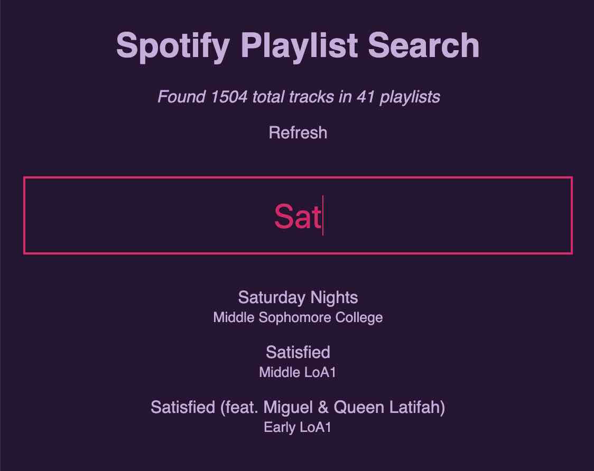

## Spotify Playlist Search

- **Context**: I make quarterly playlists on Spotify, and I don't like to repeat music from previous playlists
- **Problem**: Spotify makes it hard to search your playlists (you have to search each one)
- **Solution**: This small web-app retrieves all your playlists and let's you search the track names

Caveat: it shows the playlists owned by whichever Spotify account authorized `SPOTIFY_REFRESH_TOKEN` (mine). Playlists you only follow are excluded.

### Spotify credentials

The function needs three env vars, set on the Netlify site and in a local `.env` (gitignored) for dev:

- `SPOTIFY_CLIENT_ID` and `SPOTIFY_CLIENT_SECRET`: from the "Personal Playlist Search" app on the [Spotify developer dashboard](https://developer.spotify.com/dashboard)
- `SPOTIFY_REFRESH_TOKEN`: a user-authorized token, so private playlists are visible (client credentials alone only see public ones)

**The refresh token expires after 180 days** (see "Refresh Token Lifetime" on the dashboard). When the site starts failing with a 500, check the function logs for "Unable to refresh access token", then renew it:

1. Make sure `http://127.0.0.1:8888/callback` is a Redirect URI on the Spotify app (Spotify rejects `localhost`)
2. `SPOTIFY_CLIENT_ID=... node scripts/get-refresh-token.js`, paste the client secret when prompted, open the printed URL and approve. This writes all three values to `.env`.
3. `npx netlify-cli login` (use the personal account, not a work team; `login --new` to switch), `npx netlify-cli link --name confident-blackwell-23d9eb`, then `npx netlify-cli env:import .env`
4. Redeploy so the function picks up the new value (`npx netlify-cli api createSiteBuild --data '{"site_id":"<id>"}'`, or "Trigger deploy" in the Netlify UI), then delete `.env` if you don't want the secrets on disk

The app is in Spotify's development mode, which has a low rate limit. The function caps requests to 10 in flight and its response is cached on Netlify's CDN for 5 minutes, so repeated test calls shouldn't trip it.

### Dev

NOTE: you must provide the Spotify env vars above (e.g. via `.env`).

- Use _yarn start_ to start the dev server (both client and FaaS)
- Use _yarn test_ to run unit tests
- Use _yarn build_ to build for production

This is an application built with [AppRun](https://github.com/yysun/apprun) and using [Netlify functions](https://www.netlify.com/docs/functions/).

### Quick Thoughts

This was shockingly easy to build. AppRun has a great approach that makes it super quick to hit the ground running. I'll probably using it for quickshot projects in the future :)

### Screenshot

